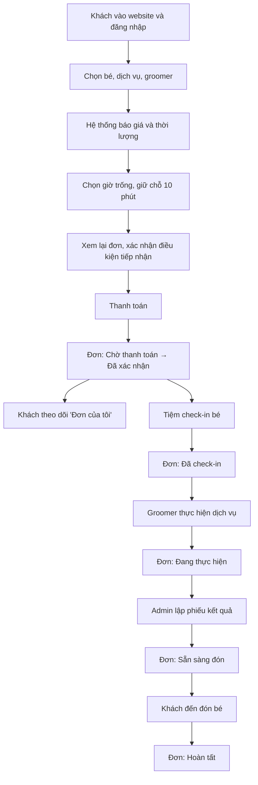

# Quy trình nghiệp vụ: Đặt lịch dịch vụ grooming

Đây là quy trình nghiệp vụ chính của PawCare, mô tả hành trình của một khách hàng từ lúc vào website đến khi xem được trạng thái đơn của mình. 

## Hành trình của khách hàng

1. **Đăng nhập** – Khách xem giá và tham khảo Lộ trình chăm sóc mà không cần đăng nhập, nhưng khi muốn đặt lịch thì bắt buộc phải đăng nhập trước.

2. **Chọn hồ sơ bé** – Chọn hồ sơ bé đã lưu hoặc tạo hồ sơ mới với các thông tin loài, cân nặng và loại lông; đây là dữ liệu nền để hệ thống tính giá và thời lượng sau này.

3. **Chọn dịch vụ và groomer** – Chọn một trong bốn dịch vụ lẻ (tắm sấy, cắt tỉa tạo kiểu, vệ sinh tai, cắt móng) hoặc một trong ba combo, rồi chọn groomer theo hình thức "Bất kỳ" để hệ thống tự gán, hoặc chỉ định groomer hiện có.

4. **Xem báo giá tự động** – Ngay khi đủ thông tin, hệ thống tra bảng giá theo mốc cân nặng và độ dài lông, cộng thêm phụ phí nếu có (lông rối, thú quá cỡ), đồng thời tính luôn thời lượng dự kiến — khách biết trước chi phí trước khi chọn giờ.

5. **Chọn giờ và giữ chỗ** – Hệ thống chỉ hiển thị những khung giờ còn đủ thời lượng theo groomer đã chọn. Khi khách chốt một khung giờ, hệ thống giữ chỗ trong 10 phút để khách kịp hoàn tất thanh toán; nếu hai khách cùng chọn trùng giờ thì chỉ một người giữ được chỗ, người còn lại được báo và gợi ý khung giờ lân cận.

6. **Xem lại đơn** – Khách xem lại toàn bộ thông tin đơn — dịch vụ, groomer, giờ hẹn, giá dự tính, ghi chú — và tick xác nhận điều kiện tiếp nhận (không nhận thú đang mang thai, đang điều trị bệnh hoặc mới phẫu thuật).

7. **(Tùy chọn) Thêm sản phẩm** – Khách có thể thêm sản phẩm (thức ăn, snack, phụ kiện) vào cùng giỏ hàng với dịch vụ trước khi thanh toán một lần duy nhất.

8. **Thanh toán** – Khách thanh toán bằng một trong ba hình thức: VNPay sandbox, trả tại tiệm, hoặc COD khi giỏ hàng có sản phẩm cần giao. Thanh toán thành công thì hệ thống xác nhận đơn ngay.

9. **Theo dõi đơn** – Khách vào mục "Đơn của tôi" để theo dõi trạng thái đơn; mỗi khách chỉ xem được đơn của chính mình.

## Quy trình phía tiệm

Khi khách đưa bé đến, nhân viên check-in và đánh giá nhanh tình trạng thực tế của bé; nếu có khác biệt so với khai báo ban đầu, Admin điều chỉnh lại mức giá và khách xác nhận trước khi tiến hành. Groomer thực hiện dịch vụ, thường mất khoảng 2–4 giờ cho một lượt grooming đầy đủ. Sau khi xong, Admin lập phiếu kết quả gồm các mục da, lông, tai, móng, răng kèm ghi chú và lưu vào hồ sơ bé, rồi báo khách đến đón.

## Trạng thái đơn theo từng mốc

Đơn dịch vụ di chuyển qua các trạng thái theo đúng trình tự: **Chờ thanh toán → Đã xác nhận → Đã check-in → Đang thực hiện → Sẵn sàng đón → Hoàn tất**. Ngoài luồng chính này còn hai trạng thái ngoại lệ là **Đã hủy** (khách hoặc tiệm hủy trước khi check-in) và **Không đến** (khách không đến đúng giờ đã đặt).

| Trạng thái | Thời điểm xảy ra | Ai cập nhật |
| --- | --- | --- |
| Chờ thanh toán | Khách vừa giữ chỗ, chưa thanh toán xong | Hệ thống |
| Đã xác nhận | Thanh toán thành công | Hệ thống |
| Đã check-in | Khách đã đưa bé đến tiệm | Admin |
| Đang thực hiện | Groomer đang thực hiện dịch vụ | Admin |
| Sẵn sàng đón | Dịch vụ hoàn tất, chờ khách đến đón | Admin |
| Hoàn tất | Khách đã nhận lại bé | Admin |
| Đã hủy | Hủy trước khi check-in | Khách hoặc Admin |
| Không đến | Khách không đến đúng giờ đã đặt | Admin |

## Sơ đồ tóm tắt

 

