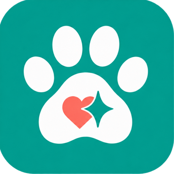

# Hệ thống thiết kế UI - PawCare (UI Design System)

Tài liệu này quy định các tiêu chuẩn về màu sắc, kiểu chữ, khoảng cách và các thành phần giao diện dùng chung cho toàn bộ website PawCare.

## 1. Bảng màu (Color Palette)

### 1.1. Màu cốt lõi

- **Màu chính (Primary):** `#007A6E` 
- **Màu logo (trang trí):** `#00A090`
- **Màu Hover:** `#00665C` 
- **Màu nhấn (Accent):** `#FC7060` 
- **Màu nền Web (Background):** `#F8F9FA` 
- **Màu nền Card:** `#FFFFFF` 
- **Màu Text chính (Primary Text):** `#212529` 
- **Màu Text phụ (Secondary Text):** `#5C6570`

### 1.2. Màu bổ sung cho Header

Các màu dưới đây chỉ dùng cho Header, được khai báo trong `:root` của `css/style.css`.

| Vai trò | Mã màu | Biến CSS | Ghi chú |
| :--- | :--- | :--- | :--- |
| Nền Header | `#E8F5F3` | `--color-header-bg` | Teal rất nhạt, tách Header khỏi nền web. |
| Đường kẻ dưới Header | `#B8DCD7` | `--color-header-line` | Chỉ trang trí, đường kẻ mảnh 1px. |
| Hover nút Đặt lịch | `#EF6551` | `--color-accent-hover` | Cam đậm hơn Accent một chút, chữ giữ `#212529`. |
| Vầng sáng focus ô tìm kiếm | `#BFDEDB` | `--color-focus-ring` | Dùng kèm viền `#00665C` khi focus. |

### 1.3. Màu dùng lại và màu tạm

- **Màu viền (`--color-border`):** dùng lại Text phụ `#5C6570`.
- **Màu nền khối phụ (`--color-surface`):** dùng lại màu nền Card `#FFFFFF`.
- **Màu khung ảnh giả (`--color-placeholder`):** `#D9D9D9`. Đây là màu **tạm** cho khung ảnh giả, sẽ xóa khi thay bằng ảnh thật.

### 1.4. Quy tắc dùng màu

- Mọi mã màu chỉ được khai báo trong `:root`. Phần còn lại của CSS dùng `var(--tên-biến)`.
- Màu logo `#00A090` chỉ dùng trang trí, không dùng cho chữ (độ tương phản trên nền trắng thấp).
- Màu Accent `#FC7060` dùng làm nền nút chính, không dùng làm màu vòng focus hoặc màu chữ.

## 2. Kiểu chữ (Typography)

Dự án sử dụng phông chữ **Nunito**.

| Phân loại | Kích thước | Trọng lượng (Weight) | Ghi chú |
| :--- | :--- | :--- | :--- |
| **H1 (Tiêu đề trang)** | `32px` (2rem) | Bold (700) | |
| **H2 (Tiêu đề phần)** | `24px` (1.5rem) | Bold (700) | |
| **H3 (Tiêu đề card/sản phẩm)** | `20px` (1.25rem)| SemiBold (600) | |
| **Body (Nội dung thường)** | `16px` (1rem) | Regular (400) | |
| **Small (Chữ nhỏ/ghi chú)** | `14px` (0.875rem)| Regular (400) |  |

## 3. Khoảng cách (Spacing)

- **8px:** Khoảng cách nhỏ (giữa các dòng chữ liền kề).
- **16px:** Khoảng cách tiêu chuẩn (padding trong thẻ card, nút bấm).
- **24px:** Khoảng cách trung bình (giữa các section nhỏ).
- **32px & 48px:** Khoảng cách lớn (giữa các section chính của trang).

## 4. Logo dự án

- **Logo vuông (Dùng cho Header/Favicon):** 
  
- **Logo đầy đủ (Dùng cho Footer/Giới thiệu):**
  

## 5. Các mốc hiển thị (Responsive Breakpoints)

- **Mobile (điện thoại):** kiểm thử ở `390px`; áp dụng khi `max-width: 599px`
- **Tablet (máy tính bảng):** kiểm thử ở `768px`; áp dụng khi `max-width: 1023px`
- **Desktop (máy tính):** kiểm thử ở `1366px`; là bố cục mặc định
- **Tablet (Máy tính bảng):** `768px` 
- **Desktop (Máy tính bàn/Laptop):** `1366px`

## 6. Quy ước đặt tên & Thành phần dùng chung

- **Thành phần dùng chung:**
  - **Nút bấm (Buttons):** Bo góc `border-radius: 8px`. Có hiệu ứng chuyển màu mượt (`0.2s`).
    - Nút chính: nền Nhấn (`#FC7060`), chữ `#212529`. Hover: nền `#00665C`, chữ Trắng.
    - Nút phụ: nền Trắng, viền Chính (`#007A6E`), chữ màu Chính. Hover: nền `#00665C`, chữ Trắng. Focus: vòng viền 2px.
  - **Thẻ (Cards):** Nền Trắng, bo góc `12px`.
  - **Header:** nền `#E8F5F3`, đường kẻ dưới `1px` màu `#B8DCD7`. Logo bên trái; bên phải là menu 3 liên kết (Trang chủ, Dịch vụ & Sản phẩm, Giới thiệu), ô tìm kiếm (chỉ giao diện), nút Đặt lịch, biểu tượng giỏ hàng.
    - **Menu:** chữ `#212529`. Hover: chữ `#00665C`, nền trắng, viền `#00665C`. Trang hiện tại (`aria-current`): chữ `#007A6E`, nền trắng, viền `#007A6E`.
    - **Ô tìm kiếm:** nền trắng, viền `1px` `#5C6570`, bo tròn hoàn toàn (`999px`), icon kính lúp bên trái. Hover: viền `#007A6E`. Focus: viền `#00665C` kèm vầng sáng `#BFDEDB`. Nhãn "Tìm kiếm" chỉ dành cho trình đọc màn hình.
    - **Giỏ hàng:** ô vuông `40px`, nền trắng, viền `1px` `#5C6570`, bo góc `8px`, icon giỏ hàng màu Chính `#007A6E`.
  - **Footer:** tên cửa hàng, 3 cột (Liên kết nhanh, Liên hệ, Giờ mở cửa), dòng bản quyền.
  - **Biểu tượng (Icons):** dùng SVG inline theo phong cách outline của thư viện Lucide, kích thước `20px`, `stroke-width="2"`, màu kế thừa qua `currentColor`. Không dùng file ảnh hoặc emoji làm icon giao diện.
  - **Liên kết và focus:** liên kết chữ màu Chính `#007A6E`, hover `#00665C`. Focus bàn phím (`:focus-visible`): vòng viền `3px` màu `#00665C`, cách `2px`.
- **Quy ước viết code giao diện:**
  - Tên class viết theo kiểu `kebab-case` (VD: `product-card`, `btn-primary`).
  - Tên file hình ảnh/logo viết chữ thường, không dấu, cách nhau bằng gạch ngang.
