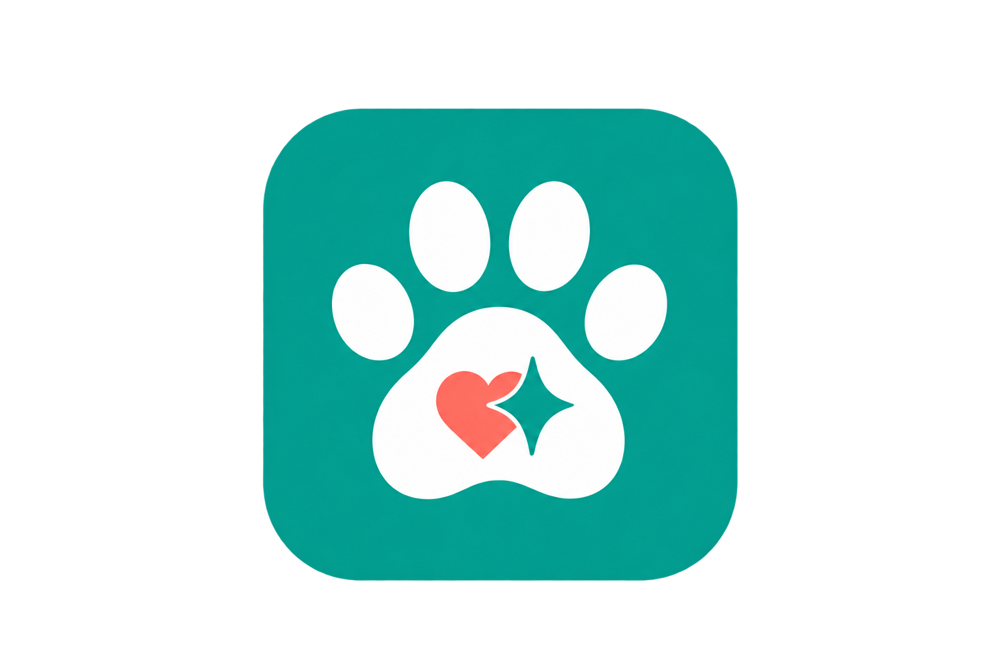

# Hệ thống thiết kế UI - PawCare (UI Design System)

Tài liệu này quy định các tiêu chuẩn về màu sắc, kiểu chữ, khoảng cách và các thành phần giao diện dùng chung cho toàn bộ website PawCare.

## 1. Bảng màu (Color Palette)

- **Màu chính (Primary):** `#007A6E` 
- **Màu logo (trang trí):** `#00A090`
- **Màu Hover:** `#00665C` 
- **Màu nhấn (Accent):** `#f78c57` 
- **Màu nền Web (Background):** `#F8F9FA` 
- **Màu nền Card:** `#FFFFFF` 
- **Màu Text chính (Primary Text):** `#212529` 
- **Màu Text phụ (Secondary Text):** `#5C6570`

## 2. Kiểu chữ (Typography)

Dự án sử dụng phông chữ **Nunito**.

| Phân loại | Kích thước | Trọng lượng (Weight) | Ghi chú |
| :--- | :--- | :--- | :--- |
| **H1 (Tiêu đề trang)** | `32px` (2rem) | Bold (700) | |
| **H2 (Tiêu đề phần)** | `24px` (1.5rem) | Bold (700) | |
| **H3 (Tiêu đề card/sản phẩm)** | `20px` (1.25rem)| SemiBold (600) | |
| **Body (Nội dung thường)** | `16px` (1rem) | Regular (400) | |
| **Small (Chữ nhỏ/ghi chú)** | `14px` (0.875rem)| Regular (400) | *In nghiêng (Italic)* |

## 3. Khoảng cách (Spacing)

- **4px:** Khoảng cách rất nhỏ (giữa icon và chữ).
- **8px:** Khoảng cách nhỏ (giữa các dòng chữ liền kề).
- **16px:** Khoảng cách tiêu chuẩn (padding trong thẻ card, nút bấm).
- **24px:** Khoảng cách trung bình (giữa các section nhỏ).
- **32px & 48px:** Khoảng cách lớn (giữa các section chính của trang).

## 4. Logo dự án

*(Bạn có thể chèn ảnh logo của nhóm vào đây)*
- **Logo vuông (Dùng cho Header/Favicon):** 
  
- **Logo đầy đủ (Dùng cho Footer/Giới thiệu):**
  

## 5. Các mốc hiển thị (Responsive Breakpoints)

- **Mobile (điện thoại):** kiểm thử ở `390px`; áp dụng khi `max-width: 599px`
- **Tablet (máy tính bảng):** kiểm thử ở `768px`; áp dụng khi `max-width: 1023px`
- **Desktop (máy tính):** kiểm thử ở `1366px`; là bố cục mặc định
- **Tablet (Máy tính bảng):** `768px` 
- **Desktop (Máy tính bàn/Laptop):** `1366px`

## 6. Quy ước đặt tên & Thành phần dùng chung

- **Thành phần dùng chung:**
  - **Nút bấm (Buttons):** Bo góc `border-radius: 8px`. 
    - Nút chính: nền Nhấn (`#FC7060`), chữ `#212529`. Hover: nền `#00665C`, chữ Trắng.
    - Nút phụ: nền Trắng, viền Chính (`#007A6E`), chữ màu Chính. Hover: nền `#00665C`, chữ Trắng. Focus: vòng viền 2px.
  - **Thẻ (Cards):** Nền Trắng, bo góc `12px`.
  - **Header:** logo bên trái; bên phải là menu 3 liên kết (Trang chủ, Dịch vụ & Sản phẩm, Giới thiệu), ô tìm kiếm (chỉ giao diện), nút Đặt lịch, biểu tượng giỏ hàng.
  - **Footer:** tên cửa hàng, 3 cột (Liên kết nhanh, Liên hệ, Giờ mở cửa), dòng bản quyền.
- **Quy ước viết code giao diện:**
  - Tên class viết theo kiểu `kebab-case` (VD: `product-card`, `btn-primary`).
  - Tên file hình ảnh/logo viết chữ thường, không dấu, cách nhau bằng gạch ngang.
  - Tên class viết theo kiểu `kebab-case` (VD: `product-card`, `btn-primary`).
  - Tên file hình ảnh/logo viết chữ thường, không dấu, cách nhau bằng gạch ngang.
